# Estudo de Lote

Ferramenta web para **estudo de viabilidade de lotes** em um mapa 3D: clique em um lote e veja na hora os dados do terreno, os parâmetros de zoneamento, o volume que dá para construir, o número de unidades e vagas e a insolação de cada fachada.

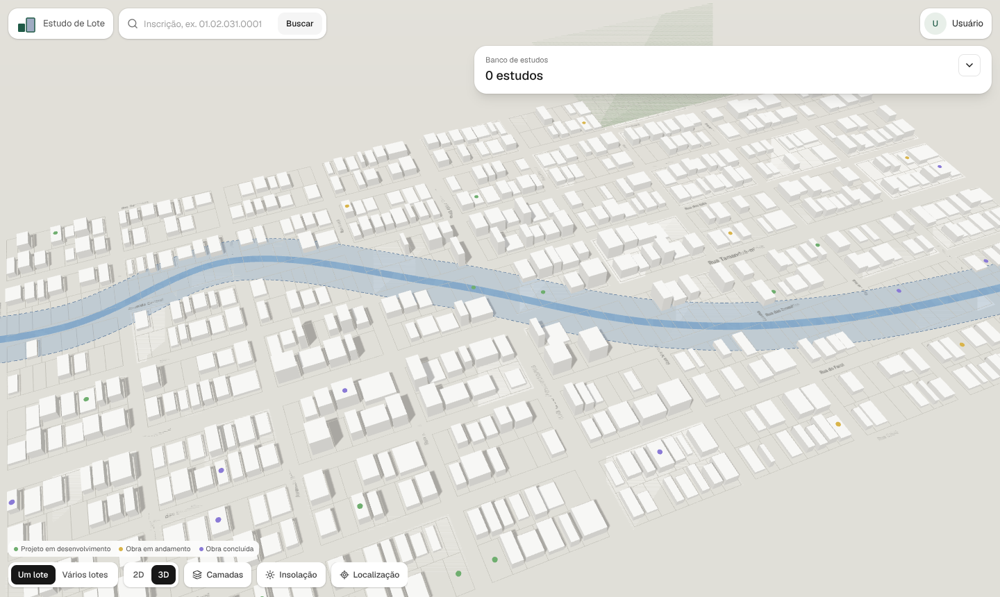

> **Atenção:** os dados que acompanham o projeto (cidade, lotes, ruas e parâmetros de zoneamento) são **fictícios**, gerados por código. Antes de usar para decisões reais, troque-os pelo cadastro e pela lei de zoneamento do seu município — veja [Usando dados reais](#usando-dados-reais).

## Funcionalidades

- **Mapa 3D** com quadras, lotes, edificações existentes, rio com faixa de APP e área de preservação. Arraste para mover, use o botão direito para girar e a roda do mouse para zoom. Alterna entre **2D** e **3D**.
- **Busca por inscrição** (ex.: `01.02.031.0001`): encontra o lote e leva o mapa até ele.
- **Um lote / Vários lotes**: no modo "Vários lotes", clique em lotes vizinhos para somá-los em um único estudo (remembramento).
- **Painel do lote**, com cinco abas:
  - **Resumo** — área, testada, cotas, desnível, declividade, rua de frente, total construído, limite pelo índice de aproveitamento (IA), pavimentos, vagas e unidades.
  - **Zoneamento** — parâmetros da lei lado a lado com os do estudo, com ✓ / ⚠ para cada item.
  - **Estudo de massa** — escolha o número de pavimentos e, se quiser, use o IA máximo (outorga onerosa). O volume aparece no mapa, pavimento por pavimento, respeitando recuos, taxa de ocupação e APP.
  - **Unidades** — uso residencial, comercial ou misto, área média por unidade/sala e eficiência; calcula unidades, salas, área privativa e vagas.
  - **Análise solar** — horas de sol direto em cada fachada no inverno, no equinócio e no verão, nascer e pôr do sol, e sombras em tempo real no mapa conforme data e hora.
- **Banco de estudos** — salve, atualize, reabra no mapa e apague estudos (ficam guardados no navegador).
- **Impressão em A4** — relatório com imagem da cena, dados do terreno, zoneamento e resultado do estudo.
- **Camadas** — liga/desliga edificações, lotes, zoneamento (cores por zona), APP, nomes de ruas e status de obras.
- **Responsivo** — no celular o painel vira uma folha na parte de baixo da tela.

| Análise solar | Vários lotes |
| --- | --- |
| 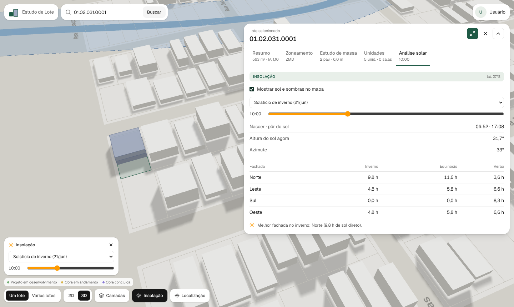 | 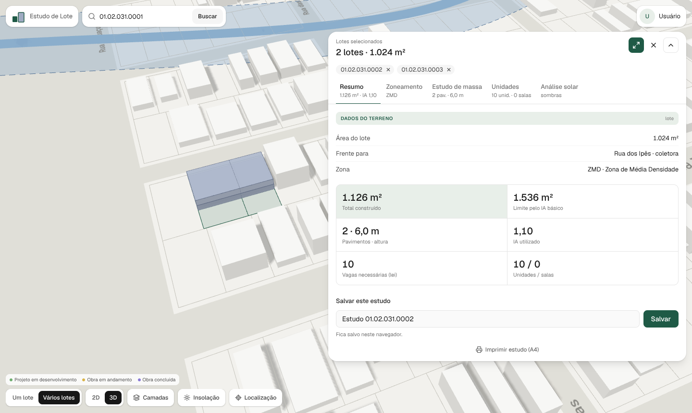 |

## Jogo: Force One

Em <http://localhost:3000/jogo> há também **Force One**, um jogo de **estratégia em tempo real** em 3D, com visual arredondado. Na tela inicial você escolhe sua facção — **Coalizão Aurora** (azul) ou **Legião Escarlate** (vermelha) — e joga **contra o computador** ou **em rede contra outro aparelho**.

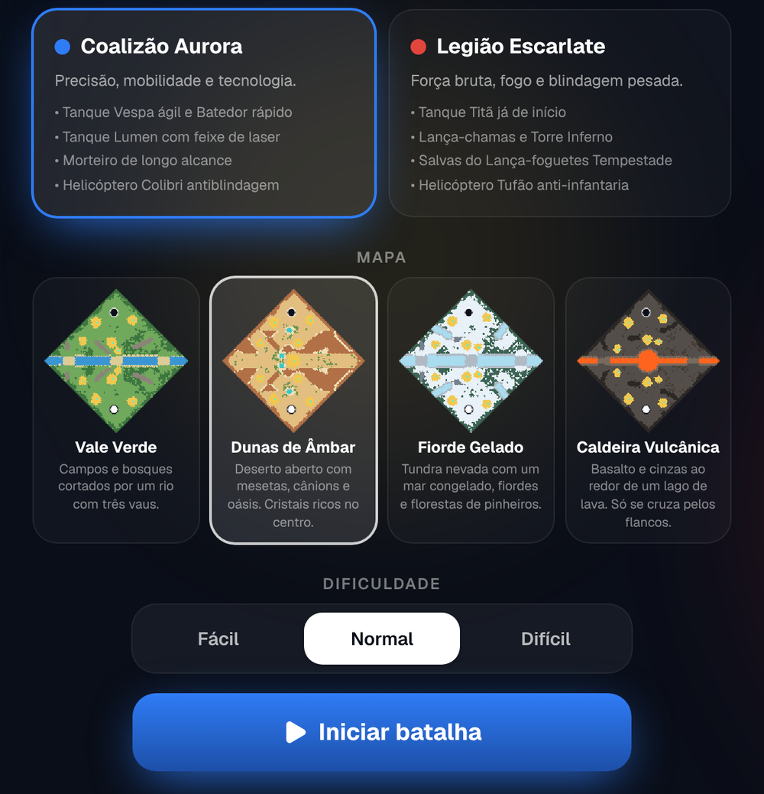

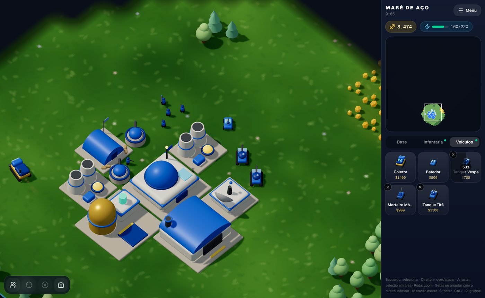

- **Economia**: Usinas geram energia; a Refinaria traz um Coletor que busca cristais dourados e os converte em créditos. Com energia baixa a produção fica lenta e torres e radar desligam.
- **Jogo em rede (2 jogadores)**: em **Em rede → Criar sala**, o jogo mostra um código de 4 letras, um QR code e um botão para compartilhar o link. No outro aparelho, basta escanear o QR, abrir o link ou digitar o código em **Em rede → Entrar**. Quem cria escolhe o mapa e a facção; o adversário fica com a outra. Cada um vê a própria base embaixo.
- **Mapas**: quatro paisagens, todas espelhadas para ser justo com os dois lados, com prévia na tela inicial:
  - **Vale Verde** — campos e bosques cortados por um rio com três vaus.
  - **Dunas de Âmbar** — deserto com mesetas e cânions, oásis com palmeiras, cactos, poeira ao vento e cristais ricos no centro.
  - **Fiorde Gelado** — tundra com mar congelado, fiordes, pinheiros nevados e neve caindo.
  - **Caldeira Vulcânica** — basalto rachado ao redor de um lago de lava; só se cruza pelos flancos. Brasas sobem da lava.

  | Dunas de Âmbar | Fiorde Gelado | Caldeira Vulcânica |
  | --- | --- | --- |
  | 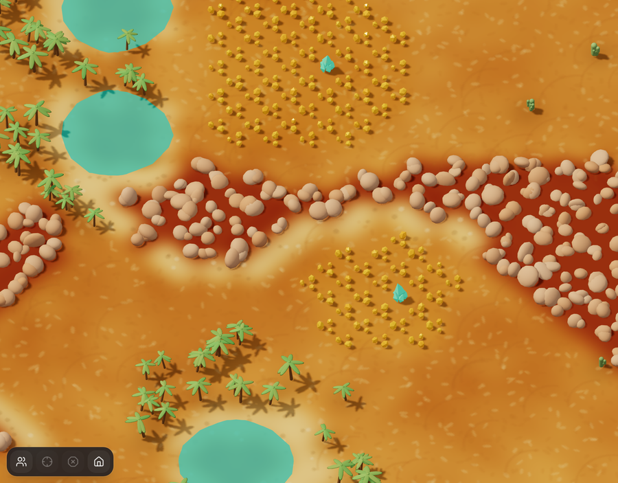 | 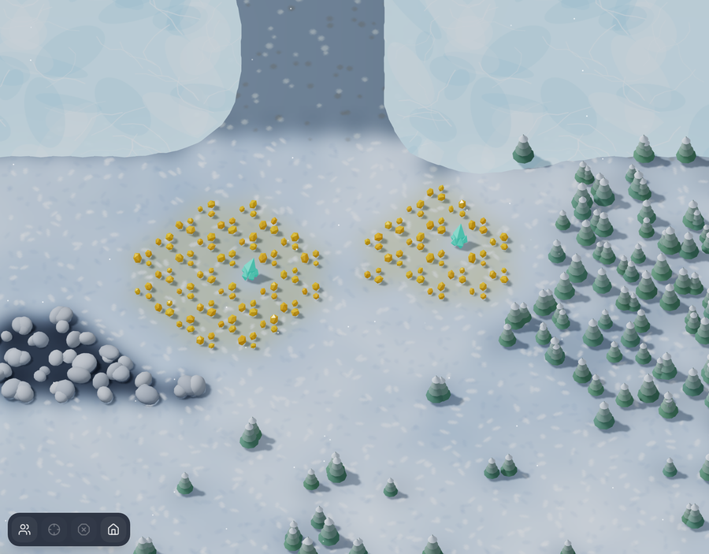 | 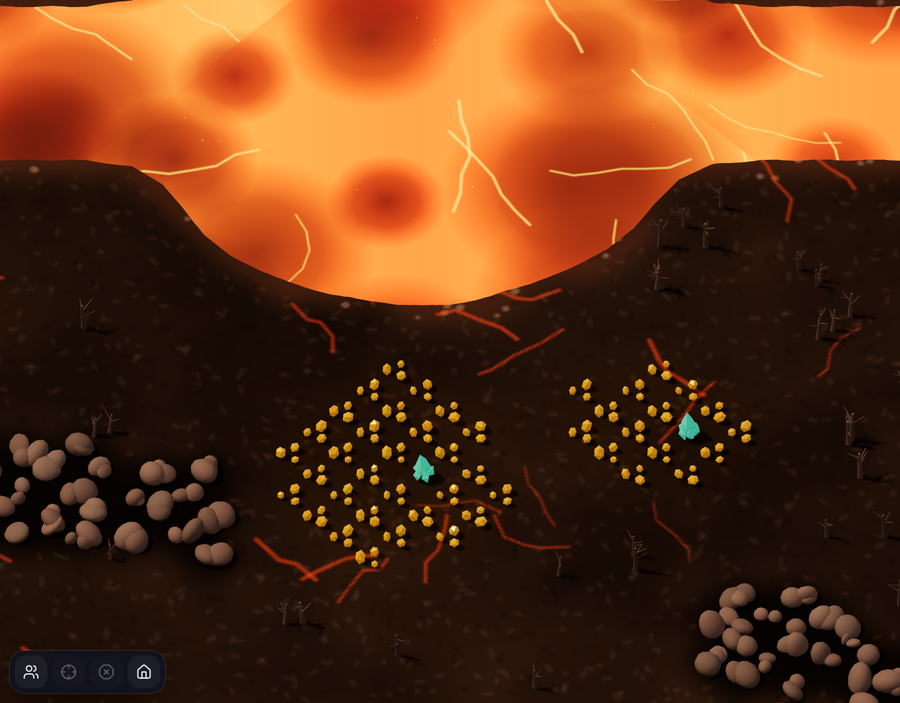 |
- **Facções**:

  | | Coalizão Aurora — mobilidade e precisão | Legião Escarlate — fogo e blindagem |
  | --- | --- | --- |
  | Infantaria | — | Lança-chamas |
  | Veículos | Batedor, Tanque Vespa, Morteiro Móvel, Tanque Lumen (laser) | Blindado Javali, Tanque Titã, Lança-foguetes Tempestade |
  | Aéreo | Helicóptero Colibri (mísseis antiblindagem) | Helicóptero Tufão (metralhadora rotativa) |
  | Defesa | Torre de Defesa (canhão) | Torre Inferno (lança-chamas) |

  Comuns às duas: Centro de Comando, Usina, Refinaria, Quartel, Fábrica de Blindados, Radar (liga o minimapa), Heliporto, Torre Antiaérea, Coletor, Fuzileiro, Lança-mísseis e Drone Vigia.
- **Combate**: tipos de arma (bala, canhão, míssil, artilharia, laser, chamas e antiaérea) contra tipos de blindagem. Dá para reparar, vender e escolher a fábrica principal.
- **Aeronaves**: voam em linha reta por cima de rios, rochas e árvores. Só armas antiaéreas as atingem: Torre Antiaérea, Fuzileiro, Lança-mísseis, Batedor, Javali e Drone; tanques, artilharia e torres terrestres não.
- **IA** em três dificuldades: ergue a base, mantém coletores, defende e ataca em ondas.
- **Névoa de guerra**, explosões, fumaça, marcas de queimado e sons sintetizados.
- **Trilha sonora adaptativa**, composta e sintetizada em tempo real (sem arquivos de áudio): um tema por facção — Aurora em ré maior, luminoso, a 104 BPM; Legião em dó menor, sombrio, a 92 BPM, com baixo distorcido — que passa de calmo para tensão (inimigos à vista) e batalha (combate ou base sob ataque), com vinhetas de vitória e derrota. Música e efeitos podem ser ligados e desligados separadamente no menu, e a escolha fica salva no navegador.
- **Controles**: mouse e teclado (esquerdo seleciona, direito comanda, A atacar-mover, S parar, Ctrl+1–9 grupos) ou toque (toque comanda, arrastar move a câmera, pinça dá zoom).

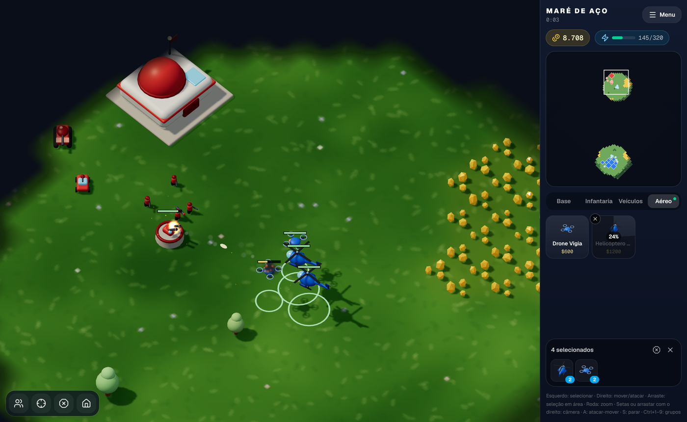

| Combate | Celular |
| --- | --- |
| 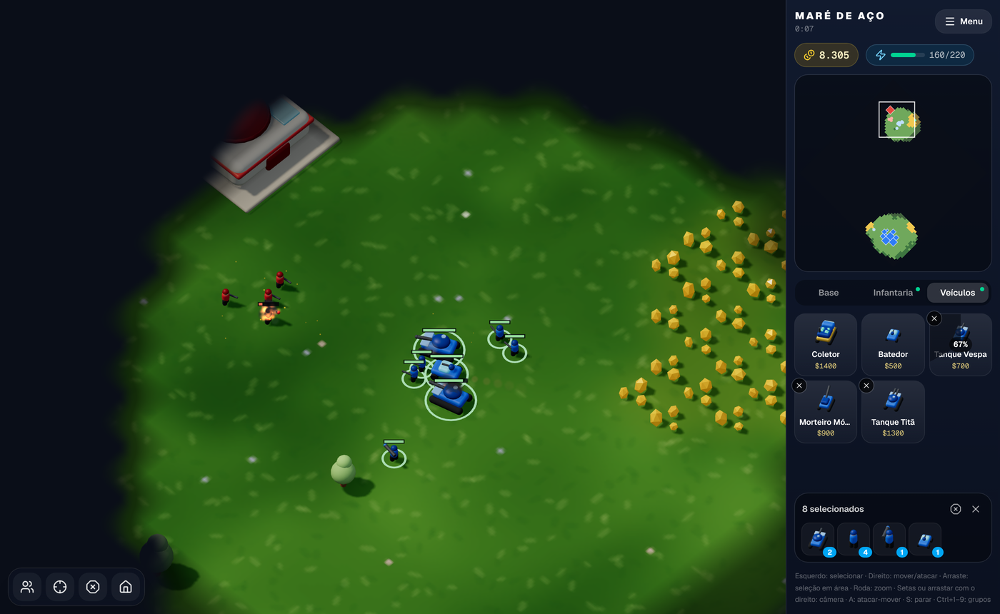 | 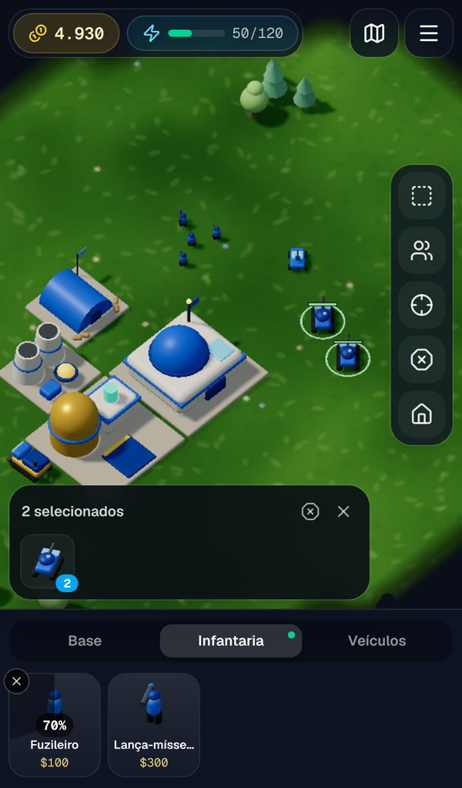 |

### Como funciona o jogo em rede


- Os aparelhos se conectam **direto um ao outro** (WebRTC, via [PeerJS](https://peerjs.com/)). O servidor público gratuito do PeerJS só serve para os dois se encontrarem; os dados da partida não passam por ele. Para redes mais restritas (como 4G), o PeerJS usa servidores de retransmissão (TURN) próprios.
- O aparelho que cria a sala é o **anfitrião**: ele roda a simulação e envia o estado ~10 vezes por segundo; o convidado mostra uma réplica suavizada e envia as ordens. Assim não há dessincronia entre navegadores diferentes (iPhone × Android).
- Em rede a partida não pausa. Se um aparelho sair, fechar a aba ou ficar 10 s sem responder (por exemplo, com a tela bloqueada), o outro vê "Conexão perdida".
- Para usar um servidor de sinalização próprio em vez do público, rode um [PeerServer](https://github.com/peers/peerjs-server) e defina, no build:

  ```bash
  NEXT_PUBLIC_PEER_HOST=salas.seudominio.com
  NEXT_PUBLIC_PEER_PORT=443
  NEXT_PUBLIC_PEER_PATH=/
  NEXT_PUBLIC_PEER_SECURE=true
  ```

## Como rodar

Pré-requisito: [Node.js](https://nodejs.org/) 24 ou mais recente.

```bash
git clone https://github.com/bruberbbs/B_design-.git
cd B_design-
npm install
npm run dev
```

Abra <http://localhost:3000>.

### Outros comandos

```bash
npm run build      # build de produção
npm run start      # serve o build de produção
npm run lint       # ESLint
npm run typecheck  # checagem de tipos do TypeScript
npm run check      # lint + typecheck + build
```

Com Docker:

```bash
docker compose up app --build   # produção
docker compose up dev --build   # desenvolvimento, na porta 3001
```

## Usando dados reais

Toda a parte de dados e cálculo fica em `src/lib/estudo/`:

| Arquivo | O que faz | O que trocar |
| --- | --- | --- |
| `zoning.ts` | Parâmetros de cada zona: IA básico e máximo, taxa de ocupação, permeabilidade, gabarito, altura do pavimento, recuos e usos. | Os valores da lei de zoneamento / plano diretor do seu município. |
| `city.ts` | Gera a cidade fictícia: quadras, lotes (com inscrição, zona, testada e frente), ruas, edificações, rio, APP e relevo (`elevation`). | Substituir `generateCity()` por uma função que leia o cadastro real (por exemplo, um GeoJSON de lotes da prefeitura) e devolva o mesmo formato `City`. |
| `study.ts` | Cálculos do estudo: projeção, total construído, IA, unidades, vagas e a análise solar. | Regras de vagas, eficiência padrão e a latitude (`LATITUDE`, hoje 27,15° S). |

Pontos de atenção ao trocar os dados:

- Os lotes hoje são **retângulos alinhados aos eixos** (coordenadas em metros, `x` = leste, `z` = sul). Lotes reais têm polígonos irregulares: será preciso adaptar o desenho em `MapScene.tsx`, o clique (que hoje testa se o ponto está dentro do retângulo) e o cálculo da projeção em `study.ts`.
- O relevo vem da função `elevation(x, z)`. Com dados reais, troque-a por uma consulta a um modelo digital de terreno ou às curvas de nível.
- As regras de vagas (1 por unidade, 2 acima de 120 m², 1 a cada 50 m² de comércio) são exemplos.

## Estrutura do projeto

```
src/
  app/
    page.tsx              # página inicial (carrega o app só no navegador)
    layout.tsx
  components/estudo/
    EstudoApp.tsx         # tela principal: busca, painel, barra inferior, banco de estudos
    MapScene.tsx          # mapa 3D em three.js (cena, câmera, seleção, massa, sombras)
    LotPanel.tsx          # abas Resumo, Zoneamento, Estudo de massa, Unidades e Análise solar
    PrintReport.tsx       # relatório A4 para impressão
    EstudoClient.tsx      # carregamento client-side (WebGL)
    types.ts
  lib/estudo/
    city.ts               # dados da cidade e do terreno
    zoning.ts             # parâmetros de zoneamento
    study.ts              # cálculos do estudo e da insolação
  app/jogo/page.tsx       # rota do jogo Force One
  components/jogo/        # interface do jogo (HUD, menus, painéis, salas em rede)
  lib/jogo/
    defs.ts               # regras: unidades, construções, armas, dificuldades
    map.ts / path.ts      # mapas (layouts e gerador simétrico) e A*
    biomes.ts             # paleta, vegetação, luz e clima de cada bioma
    game.ts               # simulação (economia, produção, combate, visão)
    ai.ts                 # IA inimiga
    input.ts / hud.ts     # controles e dados da interface/minimapa
    orders.ts             # ordens do jogador (locais ou enviadas pela rede)
    net/room.ts           # salas: código, conexão WebRTC (PeerJS), vigia de queda
    net/sync.ts           # anfitrião autoritativo: estado espelhado e réplica do convidado
    audio.ts              # efeitos sonoros sintetizados
    music.ts              # trilha sonora adaptativa (sequenciador + sintetizadores)
    render/               # cena three.js, modelos 3D, partículas e ícones
```

## Tecnologias

- [Next.js 16](https://nextjs.org/) (App Router), React 19 e TypeScript
- [three.js](https://threejs.org/) para o mapa 3D e as sombras
- Tailwind CSS v4 e ícones [Lucide](https://lucide.dev/)

## Limitações atuais

- Não há login: os estudos ficam salvos apenas no navegador (`localStorage`) e não são compartilhados entre dispositivos.
- Os dados e os parâmetros urbanísticos são ilustrativos. O resultado é um **estudo preliminar** e não substitui a consulta de viabilidade na prefeitura.

## Origem e licença

Projeto criado a partir do template [ai-website-cloner-template](https://github.com/JCodesMore/ai-website-cloner-template), distribuído sob a licença MIT (veja [LICENSE](LICENSE)).
